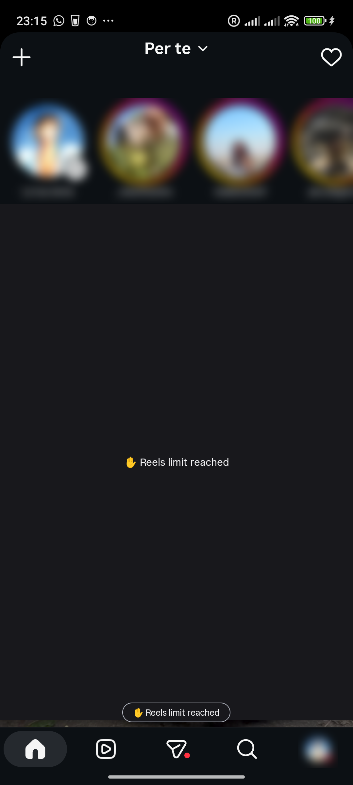
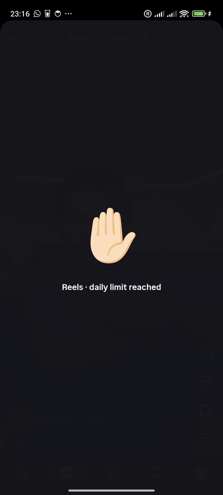
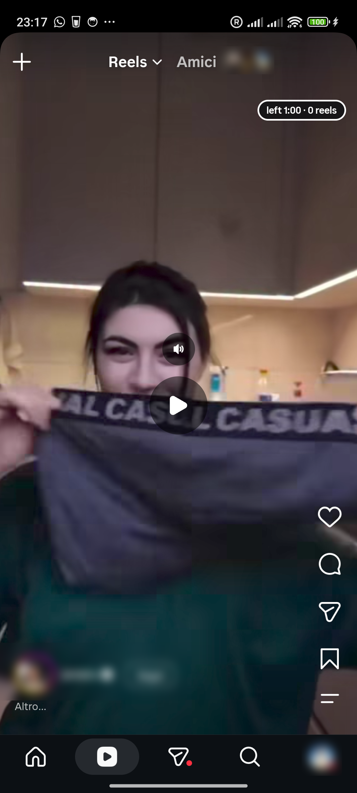
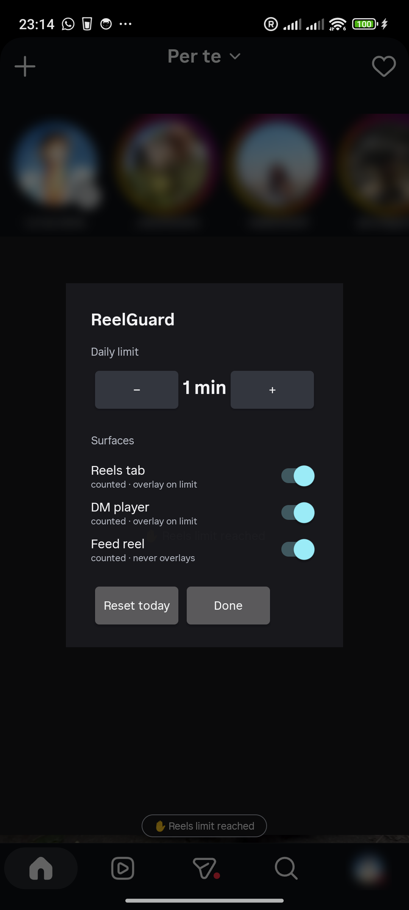

# ReelGuard

**A daily time limit for Instagram Reels — baked into Instagram itself.**

ReelGuard is not an app you install alongside Instagram. You build a small Kotlin
module, embed it directly into Instagram's dexes, re-sign the apk, and install
that. No root, no Xposed, no accessibility services, no second process: one
extra `invoke-static` in Instagram's application class is the entire
integration surface.

```
Instagram (patched) ─┬─ classes3.dex  ← +1 call: InstagramAppShell.onCreate → EmbeddedEntry.onApp
                      └─ classes24.dex ← the whole ReelGuard module
```

## Screens

| | |
| --- | --- |
|  |  |
| *Quiet-hours: opaque ✋ cover on the centered feed reel, ribbon above the tab bar.* | *Reels tab: the full-screen daily-limit cover.* |
|  |  |
| *Live HUD — time left and reels watched today.* | *In-app settings, via long-press on the Reels tab.* |

## What it does

- **Per-surface daily budgets.** Three surfaces are tracked independently:
  the Reels tab, reels/movies played from DMs, and reels inline in the home
  feed. Budgeted time accrues only while the video actually plays and the
  screen is on; local midnight rolls the ledger over.
- **Enforcement, in-process.** When a budget is spent, ReelGuard pauses the
  video — by injecting a *real* tap through Instagram's own gesture stack, or
  the pause button when present, never a blind toggle — and raises a
  full-screen ✋ “daily limit reached” cover that absorbs touches until you
  back out. A `4:12 left`-style HUD counts down while you watch.
- **Update-tolerant detection.** Surfaces are classified by sets of Instagram
  *view-id names* (`clips_video_container`, `reply_bar_container`, …) read
  from the live view hierarchy — no class names, no obfuscated symbols, no
  accessibility events. The rules are **data**, so an Instagram update is
  normally just a re-harvested id table ([docs/DETECTION.md](docs/DETECTION.md)).
- **Pause-verify loop.** Every pause is verified ~400 ms later by re-probing
  the paused-marker (`clips_pause_button` present ⟺ paused, live-verified on
  IG 453); unconfirmed pauses are retried up to 6×, and the final state is
  logged loudly. Playback is never blind-toggled.
- **Feed quiet-hours.** When the *Reels-tab* budget is spent, the home feed
  quiets down too: the centered reel-post gets an opaque ✋ cover (never over
  the stories tray or tab bar, hidden while you scroll) plus a slim
  non-clickable ribbon above the tab bar — the feed stays scrollable. A
  best-effort pause/mute walk (view tree, then declared fields, two levels
  deep) tries to still the cell's player; since IG's player is obfuscated and
  exposes no public ExoPlayer in any dex, the cover — not the pause — is the
  deterministic quiet. An anti-chore *quiet-scroll nudge* (one skip-drag per
  centered cell, chained/capped) is built and tested but **ships
  flagged off**.
- **Reels/day counter.** The HUD grows a second chamber: `left 4:12 · 17
  reels`. A reel counts when a tracked surface's pager advances to a new item
  while that surface is current, playing and budgeted — the entry reel never
  counts, re-entries can't double-credit, and the counter is display-only
  (nothing in enforcement reads it). Reset with the daily reset.
- **Settings where you already are.** Long-press the Reels tab in the bottom
  bar: per-surface toggles, a 1–480 min limit stepper (1-min steps under 5),
  reset-today. A cold-start prompt appears if IG opens with the budget spent.
- **Zero dependencies, zero resources. The module never touches its own
  `R.*`:** every id is resolved against the host at runtime and every string
  is a literal, because the dex is merged into the host where resource tables
  collide. Every view is theme-wrapped (`Theme_DeviceDefault`) — IG's runtime
  theme crashes foreign views otherwise.

## Requirements

- JDK 17, Android SDK (platform 35) — for the module build. Fresh clones
  self-configure: `settings.gradle.kts` provisions `local.properties` from the
  usual SDK locations unless `ANDROID_HOME` already serves platform 35.
- [`adb`](https://developer.android.com/tools/adb) and a device with Instagram
  453.0.0.55.79 for the known-good detection rules (older/newer builds: see
  [docs/DETECTION.md](docs/DETECTION.md))
- `python3`, `zip`, and Android build-tools (`zipalign`, `apksigner`) for the
  patch pipeline; the smali/APKEditor jars are fetched by script

## Build & install

**Prebuilt?** Grab `instagram-reelguard-<v>.apk` from the
[Releases page](https://github.com/pyerino/instagram-reelguard/releases) and
jump to step 5 — signature/update-compatibility notes in
[docs/RELEASING.md](docs/RELEASING.md).

```bash
# 1. the module (plain Gradle; debug apk is the artifact that gets embedded)
./gradlew :app:assembleDebug
#    → app/build/outputs/apk/debug/app-debug.apk

# 2. toolchain for the dex surgery
pipeline/fetch-tools.sh

# 3. merge your device's Instagram splits (base.apk + split_config.*)
pipeline/merge-splits.sh /path/to/splits

# 4. embed + sign (generates signing/reelguard.keystore on first run)
pipeline/embed-patch.sh app/build/outputs/apk/debug/app-debug.apk
#    → instagram-reelguard.apk

# 5. install. The signature differs from Play's: uninstall stock IG first.
adb uninstall com.instagram.android
adb install instagram-reelguard.apk
```

Full pipeline reference, the `classes24` invariant, and the retargeting
runbook: **[docs/BUILD.md](docs/BUILD.md)**.

## Using it

| Action | How |
| --- | --- |
| Open settings | long-press the **Reels** tab in the bottom bar |
| Limit today's reels | stepper in the dialog (per-surface toggles below it) |
| See time left | the HUD pill — `left m:ss · N reels` — on budgeted surfaces |
| When the limit hits | the video pauses and a full-screen ✋ cover appears; back out |
| Snooze / extend | *+5 min* style grants via adb (below) or the dialog |

Debug & automation broadcasts (all target the host package):

```bash
adb shell am broadcast -p com.instagram.android -a dev.pier.reelguard.SET_LIMIT --ei minutes 1
adb shell am broadcast -p com.instagram.android -a dev.pier.reelguard.SNOOZE --ei minutes 5
adb shell am broadcast -p com.instagram.android -a dev.pier.reelguard.RESET_TODAY
adb shell am broadcast -p com.instagram.android -a dev.pier.reelguard.SHOW_SETTINGS
# any of the above + --ez probe true → 60 s ground-truth dump on ReelGuardProbe
```

Logs: control flow on **`ReelGuardPatch`**, ground-truth probe on
**`ReelGuardProbe`**.

## Limitations

- **Play updates overwrite the custom build.** After an in-Play update, re-run
  the pipeline against the new splits. Detection rules usually survive; if ids
  moved, re-harvest per [docs/DETECTION.md](docs/DETECTION.md).
- **Signature change ⇒ re-login.** Installing over (or rolling back to) a
  build signed differently wipes app data — uninstall first, expect one login.
- Insertion point is pinned to `com.instagram.app.InstagramAppShell`; a
  renamed application class needs a one-line recipe change (docs/BUILD.md).
- Single-process (`main`): the pause/cover handles the frontmost video only.
- Picture-in-picture reels are a separate window and are not counted yet.
- **Feed quiet-hours is honest best-effort.** It keys off the *Reels-tab*
  budget (not a separate feed budget), the pause/mute walk cannot be verified
  in-process (IG's player is obfuscated; no public ExoPlayer in any dex), and
  recycled cells restart autoplay — the opaque cover, not the pause, is the
  guarantee. Surfaces matrix: [docs/ARCHITECTURE.md](docs/ARCHITECTURE.md).

## Repository layout

```
app/                 the ReelGuard module (embedded into IG's dexes)
  src/main/java/dev/pier/reelguard/
    core/            budget engine: accrual, rollover, snooze, rules model
    data/            SharedPreferences stores + embedded IG detection rules
    igpatch/         entrypoint, 1 Hz enforcement, probe, video control, UI
gradle/              wrapper + version catalog
pipeline/            split-merge, dex-embed, signing and release-cutting scripts
signing/             keystore generator + properties template (git-ignored)
docs/                BUILD · ARCHITECTURE · DETECTION · RELEASING
AGENTS.md            the guide for AI collaborators — read before hacking
```

## Provenance

ReelGuard v1 was a standalone accessibility-service companion app; its budget
engine and test suite were vendored verbatim into `app/…/core` and the
companion retired. This repository is the successor: one artifact, zero
runtime footprint outside Instagram.

## Development

```bash
./gradlew --no-daemon :app:testDebugUnitTest :app:assembleDebug
```

The engine (`core/`, `data/`) is plain JVM Kotlin and unit-tested; the
device-facing layer is deliberately thin. History is conventional commits
(`feat`, `fix`, `docs`, `chore`, …). Before changing behavior, read
[AGENTS.md](AGENTS.md) — it lists the invariants that are easy to break and
annoying to debug (theme-wrapping, the no-resources rule, verify-before-tap).
Publishing a versioned apk: [docs/RELEASING.md](docs/RELEASING.md).

## Credits & license

Built on the excellent [smali/baksmali](https://github.com/google/smali) and
[APKEditor](https://github.com/REAndroid/APKEditor). Instagram is a trademark
of Meta Platforms, Inc.; this project is unaffiliated.

MIT — © 2026 Pierantonio D'Agostino, see [LICENSE](LICENSE).
